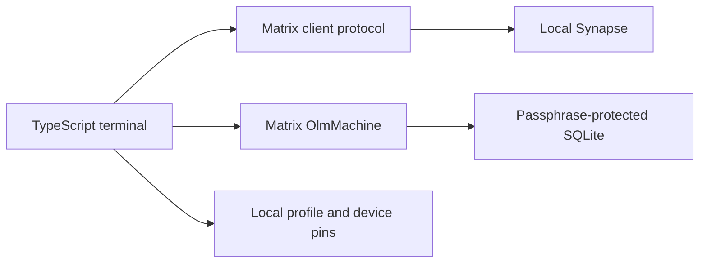

[English](technical-design.md) | [Türkçe](technical-design.tr.md)

# Heartwood terminal client technical design

## SDK decision

On Node.js 24.20.0, `matrix-js-sdk@45.0.0` (Apache-2.0) initialized Rust/WASM cryptography and exposed a verification API. The Node environment lacked built-in IndexedDB. The documented in-memory mode falls short of the persistent profile requirement. [SDK documentation](https://matrix-org.github.io/matrix-js-sdk/)

`@matrix-org/matrix-sdk-crypto-nodejs@0.6.6` (Apache-2.0) installed on Windows. Two independent Node processes opened the same passphrase-protected SQLite store and produced identical Ed25519 and Curve25519 public keys. The binding provides the Olm/Megolm state machine. Heartwood handles Matrix HTTP requests, sync, and the terminal workflow. The binding at this version lacks interactive SAS, so verification uses device-code comparison over a trusted second channel. [Node binding](https://github.com/matrix-org/matrix-rust-sdk-crypto-nodejs) · [Matrix client protocol](https://spec.matrix.org/latest/client-server-api/)

## Design

- Local Synapse registration uses a token with time or use limits. The terminal prompts for the username and password. The client connects only over HTTPS or loopback HTTP and works with users on the same Matrix homeserver.
- A local profile is bound to one user, server and Matrix device ID. Each launch logs in to the same device using the password. The access token stays in process memory. `/exit` closes the local session and preserves the server-side device record for the next login. The profile lock prevents concurrent opens of the same store. The client stores keys in the SDK's passphrase-protected SQLite store. A new device cannot recover old history after key loss.
- A chat request is a private Matrix room invitation to a full user ID. Heartwood creates the room with a Heartwood marker, invite-only membership, history visible from joining, Megolm, and federation disabled. It verifies room settings and two-person membership before acceptance and sending. Rejecting an invitation leaves the room. Blocking updates both the local blocklist and Matrix ignored-user data. The blocker closes the existing chat and leaves its room.
- Both users compare the user ID, device and full SHA-256 code shown by `/identity` over a trusted second channel. The code derives from the two public keys. `/verify` pins the device when its code matches the current single device. Sending stops for multiple devices, key changes, missing verification, missing encryption or an unexpected key recipient. A device that already received the room key may retain access, so this version prevents replacing an existing device pin with a new one.
- OlmMachine processes device events received from `/sync`. Heartwood sends the SDK's key requests and feeds back the responses. After the store records the keys, the local profile saves the sync cursor and only the room and sender IDs of pending invitations. The next login resumes from that cursor. Text sends use only `m.room.encrypted`. History is fetched from the server as encrypted events, decrypted locally, and checked against the sender's device pin. The terminal displays content only when it can decrypt and verify it. The client has no automatic send queue.
- Live chat uses the same Matrix boundary for the first history page and forward reads. Each cycle processes at most one forward page. Live chat and history share decryption and sender-device checks. Memory holds the last 512 event IDs, last 64 forward cursors, and up to 50 undecrypted encrypted events.
- Transient transport errors and gateway errors 502 through 504 trigger up to five automatic read attempts. Live reads use a single chain that aborts on exit. A successful page advances the cursor under the existing pagination contract.
- An uncertain send keeps the transaction path, recipient device ID, and encrypted payload in the same process. Before retrying, the client checks current membership and device trust. Up to 32 rooms may each hold one pending transaction. The server's event ID confirms acceptance. The client tracks server acceptance only. [Matrix transaction ID scope](https://spec.matrix.org/latest/client-server-api/#transaction-identifiers)
- The pending-send list contains only room IDs. After discard confirmation, the client checks that the same pending record is idle. Discarding clears local retry data and preserves any server event.
- The operating system's SQLite lock determines profile ownership independently of PID reuse. The client takes over a marked stale lock only when it can acquire the database write lock. It stops for an unmarked or unreadable legacy lock. Native Windows behavior was tested with separate processes in the local workspace.

## Threat boundary

Each paginated history read checks current room membership, blocking, Megolm, and sender-device verification. Main-prompt pagination cursors stay in memory per room. A failed read preserves the last valid cursor. Decrypted content and pagination cursors stay off disk.

The server sees metadata such as membership, timing, device IDs, IP addresses, and traffic volume. The local profile owner, terminal history, screen, and endpoint are within the security boundary. Verification requires comparison over a trusted second channel. Blocking leaves previously received content accessible. The initial portfolio scope is one device per person in a controlled two-account scenario. Key backup, federation, multiple devices, voice, and file transfer are outside the scope.

Live catch-up depends on the server retaining history the account can access. Undecrypted events that exceed the memory limit drop out of automatic retries and can be retried with the history command. Exiting the process clears the live session cursor and uncertain-send records. The profile lock is designed for local filesystems.

The lab pins Synapse 1.164.2. The client's TypeScript version is 5.9.3. Heartwood's publication and licensing decisions are separate. [Synapse release](https://github.com/element-hq/synapse/releases/tag/v1.164.2) · [TypeScript license](https://github.com/microsoft/TypeScript/blob/main/LICENSE.txt)
