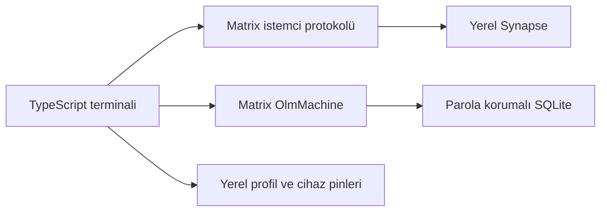

[English](technical-design.md) | [Türkçe](technical-design.tr.md)

# Heartwood terminal istemcisi teknik tasarımı

## SDK kararı

Node 24.20.0 üzerinde `matrix-js-sdk@45.0.0` (Apache-2.0) Rust/WASM kriptografisini başlattı ve doğrulama API'si sundu. Node ortamında yerleşik IndexedDB bulunmadı. Belgelenmiş bellek modu kalıcı profil gereksinimini karşılamıyor. [SDK belgeleri](https://matrix-org.github.io/matrix-js-sdk/)

`@matrix-org/matrix-sdk-crypto-nodejs@0.6.6` (Apache-2.0) Windows'ta yüklendi. İki bağımsız Node süreci aynı parola korumalı SQLite deposunu açtı ve aynı Ed25519 ve Curve25519 açık anahtarlarını üretti. Bağlayıcı Olm/Megolm durum makinesini sağlıyor. Matrix HTTP çağrıları, eşzamanlama ve terminal akışı Heartwood'a ait. İnteraktif SAS bu sürümün bağlayıcı API'sinde yer almadığından doğrulama, güvenilir ikinci kanaldan cihaz kodu karşılaştırmasıyla yapılır. [Node bağlayıcısı](https://github.com/matrix-org/matrix-rust-sdk-crypto-nodejs) · [Matrix istemci protokolü](https://spec.matrix.org/latest/client-server-api/)

## Tasarım

- Yerel Synapse kaydı süreli veya kullanım sayısı sınırlı kayıt belirteciyle açılır. Kullanıcı adı ve parola terminalden alınır. İstemci yalnızca HTTPS veya loopback HTTP'ye bağlanır ve aynı Matrix alanındaki kullanıcılarla çalışır.
- Bir yerel profil bir kullanıcı, sunucu ve Matrix cihaz kimliğine bağlıdır. Her açılışta parola ile aynı cihaza giriş yapılır. Erişim belirteci süreç belleğinde tutulur. `/cikis` yerel oturumu kapatır ve sonraki açılış için sunucudaki cihaz kaydını korur. Profil kilidi aynı deponun eşzamanlı açılmasını engeller. İstemci parola korumalı SDK SQLite deposunda anahtarları saklar. Anahtar kaybı sonrası yeni cihazda eski geçmiş kurtarılmaz.
- Sohbet isteği, tam kullanıcı kimliğine özel Matrix oda davetidir. Heartwood oda işareti, davetle giriş, katılımdan itibaren geçmiş, Megolm ve federasyon kapalı oda ayarları oluşturulurken verilir. Davet kabulü öncesi ve gönderim sırasında oda ve iki kişilik üyelik doğrulanır. Ret davetten ayrılır. Engelleme yerel engel listesi ve Matrix ignored-user kaydıyla uygulanır. Mevcut sohbet, engelleyen tarafta kapatılır ve odadan ayrılır.
- İki kullanıcı `/kimlik` çıktısındaki kullanıcı kimliği, cihaz ve iki açık anahtardan türetilen tam SHA-256 kodunu güvenilir ikinci kanaldan karşılaştırır. `/dogrula` güncel tek cihaz koduyla eşleşirse cihaz pinlenir. Birden çok cihaz, anahtar değişimi, eksik doğrulama, eksik şifreleme veya beklenmeyen anahtar dağıtım hedefi gönderimi durdurur. Eski oda anahtarını almış bir cihaza erişim sürebileceğinden bu sürüm, mevcut cihaz pinini yeni bir cihazla değiştirmez.
- OlmMachine, `/sync` ile gelen cihaz olaylarını işler. Uygulama SDK'nın anahtar isteklerini iletir ve yanıtlarını geri besler. Anahtarlar depoya işlendiğinde eşzamanlama imleci ve bekleyen davetlerin yalnızca oda/gönderen kimlikleri yerel profile kaydedilir. Yeniden açılışta istemci bu imleçten devam eder. Odaya metin için yalnızca `m.room.encrypted` gönderilir. Geçmiş sunucudan şifreli olay olarak okunur, yerelde çözülür ve gönderen cihaz piniyle karşılaştırılır. Çözülemeyen veya doğrulanamayan içerik gösterilmez. İstemci otomatik gönderim kuyruğu tutmaz.
- Canlı sohbet ilk geçmiş sayfası ve ileri okuma için aynı Matrix sınırını kullanır. Her turda en fazla bir ileri sayfa işlenir. Şifre çözme ve gönderen cihaz kontrolleri geçmişle ortaktır. Son 512 olay kimliği, son 64 ileri imleç ve en fazla 50 çözülmemiş şifreli olay bellekte tutulur.
- Geçici taşıma ve 502–504 ağ geçidi hataları en fazla beş otomatik okumayı tetikler. Canlı okuma tek zincirle çalışır ve çıkışta iptal edilir. Başarılı sayfa imleci mevcut gezinme sözleşmesine göre ilerletir.
- Sonucu belirsiz gönderim aynı süreçte işlem yolu, alıcı cihaz kimliği ve şifreli yükle bekler. Tekrar öncesinde güncel üyelik ve cihaz güveni kontrol edilir. En fazla 32 odada birer işlem bekleyebilir. Sunucunun döndürdüğü olay kimliği kabul kanıtıdır. Alıcının okuma durumu izlenmez. [Matrix işlem kimliği kapsamı](https://spec.matrix.org/latest/client-server-api/#transaction-identifiers)
- Bekleyen gönderim listesi yalnızca oda kimlikleri içerir. Vazgeçme onayı verildiğinde aynı bekleyen kaydın boşta olduğu doğrulanır. Takip bırakıldıktan sonra yerel tekrar bilgisi silinir ve sunucudaki olay korunur.
- Profil sahibi işletim sistemi SQLite kilidiyle belirlenir. PID yeniden kullanımı karar üzerinde etkili değildir. İşaretli eski kilit ancak veritabanının yazma kilidi alınabildiğinde devralınır. İşaretsiz veya okunamayan eski kilitte istemci durur. Windows davranışı yerel çalışma alanında ayrı süreçlerle test edildi.

## Tehdit sınırı

Sayfalı geçmiş her okumada mevcut oda üyeliği, engelleme, Megolm ve gönderen cihaz doğrulaması kontrollerini kullanır. Ana komut ekranının gezinme imleçleri oda başına bellekte tutulur. Başarısız sayfa okuması son geçerli imleci korur. Bu özellik çözülen içeriği ve gezinme imleçlerini diske yazmaz.

Sunucu üyelik, zaman, cihaz kimlikleri, IP ve trafik miktarı gibi metaveriyi görür. Yerel profil sahibi, terminal geçmişi, ekran ve uç cihaz güvenlik sınırındadır. Güvenilir ikinci kanaldan karşılaştırma koşulu vardır. İstemci engeli alınmış içerikleri geri alamaz. İlk sürüm tek cihazlı, kontrollü iki hesaplık portföy çalışmasıdır. Anahtar yedeği, federasyon, çoklu cihaz, ses ve dosya aktarımı kapsam dışıdır.

Canlı telafi, sunucunun hesabın erişebildiği geçmişi tutmasına bağlıdır. Bellek sınırını aşan çözülmemiş olaylar otomatik tekrar listesinden düşer ve geçmiş komutuyla yeniden denenebilir. Süreç kapanınca canlı oturum imleci ve belirsiz gönderim kaydı silinir. Profil kilidi yerel dosya sistemi için tasarlandı. Ağ ve paylaşımlı dosya sistemleriyle ilgili bir destek iddiası yoktur.

Synapse 1.164.2 yerel laboratuvar için sabitlendi. İstemcinin TypeScript sürümü 5.9.3. Heartwood için yayın veya lisans kararı ayrıdır. [Synapse sürümü](https://github.com/element-hq/synapse/releases/tag/v1.164.2) · [TypeScript lisansı](https://github.com/microsoft/TypeScript/blob/main/LICENSE.txt)
